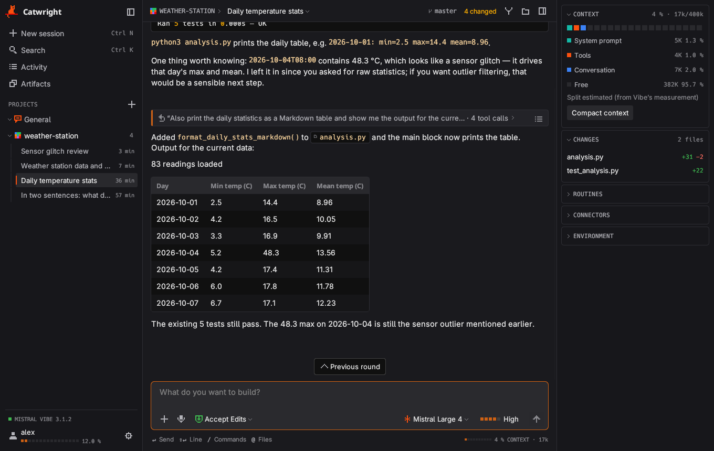

# Catwright

[](https://github.com/FreshKnoppers/Catwright/actions/workflows/ci.yml)

A native desktop app for the **Mistral Vibe** coding agent, written in Rust
(egui). Catwright runs the Vibe CLI in the background (`vibe-acp`, Agent
Client Protocol) and shows sessions, tool calls, approvals, diffs, subagents
and context usage in a window of its own.

The app speaks English and German (Deutsch).

> **Unofficial.** Catwright is a community project and is not affiliated
> with Mistral AI. "Mistral" and "Vibe" are trademarks of their respective
> owners; they are named here only to describe what the app works with.

> **Vibe-coded.** Nearly all of the code was written by AI coding agents
> (Claude Code and Mistral Vibe), steered and tested by the maintainer. It
> has an automated test suite, but no human has reviewed it line by line.
> Use it with that in mind, and please report bugs.



<details>
<summary>More screenshots</summary>

An interactive answer: Vibe reads a house's sensor logs and energy bill and
answers with a temperature chart, a pie chart and a savings calculator that
updates while you drag the sliders:


Subagents with the plan and their status bars in the side panel:


A project's start screen:


The preview pane in Diff mode next to the transcript
(`--project ~/my/project --session <id> --open analysis.py --preview-diff`):


The activity feed with a waiting approval and a finished turn (`--activity`):


</details>

The screenshots show demo projects with prepared sessions
(`tools/screenshots/render.sh` renders them).

## Features

- Several projects and sessions in one sidebar; load, fork, rename and delete
  sessions
- Vibe's approvals and questions as cards; mode and model picker, thinking
  level per model
- Diffs, review of a turn's changes, rewind to an earlier state
- Review comments on diff lines, sent to Vibe as one message ("Send to Vibe")
- Preview pane beside the transcript: code with line numbers or the diff
  against the last commit (Code/Diff switch, `--open <file>` on start)
- Transcript detail levels (Compact/Standard/Detailed/Verbose) while a turn runs
- Activity feed across all sessions: answer a waiting approval right there,
  finished and failed turns at a glance, unread badge and archiving
- File chips in answers: mentioning a workspace file opens the preview on click
- Drag & drop files onto the composer to attach them
- Worktrees: create one from any start ref as its own workspace, see and
  delete a project's worktrees in the sidebar
- Command palette (Ctrl K) finds sessions, actions and the project's files
- Per-round detail: every tool call of a round with its status and how long
  it ran
- Optional desktop notifications when a turn finishes or needs an approval
  while the window is in the background (Settings → General, off by default)
- Routines: a prompt Vibe repeats on an interval (`30m`, `2h`, `1d`) while
  the session is open
- Subagents with status bars (and a small pixel cat)
- Context usage as Vibe reports it (the same numbers as the CLI footer), with
  Vibe's own estimate of what fills it
- Interactive ```ui blocks: Vibe can put forms and buttons into its answers
  (skill `catwright-ui`, installed on request)
- English and German UI: the first start asks for the language; change it
  later under Settings → General. More languages are one more gettext file in
  `app/i18n/`.

## Privacy

- Catwright only uses your Vibe account through the Vibe CLI. The app
  never touches API keys and stores no credentials.
- No telemetry. Network traffic only comes from Vibe itself, and only when
  you trigger something.
- Settings live locally in `~/.config/catwright/`.
- Desktop notifications are off by default. When turned on, they name only
  the project, never the session title, the prompt or the answer.
- File chips only check whether a mentioned file exists; the file is read
  only when you open it.

## Requirements

- Linux (Wayland or X11). Other systems are untested.
- [Mistral Vibe](https://github.com/mistralai/mistral-vibe) installed and
  signed in: run `vibe` once in a terminal and follow the login. Tested with
  Vibe 3.1.0 to 3.1.3.
- Optional: `notify-send` (libnotify) for desktop notifications.
- To build: a current stable Rust toolchain (`rustup`).

## Known limits

- Subagents only show up when Vibe starts them through its own agent
  function. When Vibe starts further `vibe -p` processes instead (for
  example to give an agent a different model), those are separate sessions
  with no link to the original one.
- Routines run only while their session is open in Catwright and idle;
  Vibe's ACP interface takes intervals only, no cron expressions.
- Tested on Linux only, with Vibe 3.1.0 to 3.1.3.

## Download

Each [release](https://github.com/FreshKnoppers/Catwright/releases) has a
ready-built archive for Linux x86_64 (glibc 2.39 or newer):

```sh
tar xzf catwright-v0.3.0-x86_64-linux.tar.gz
cd catwright-v0.3.0-x86_64-linux
./dist/install.sh
```

## Build and install

To build it yourself instead:

```sh
cd app
cargo build --release
../dist/install.sh
```

`install.sh` installs for the current user only, without root:

- `~/.local/bin/catwright`
- a menu entry in `~/.local/share/applications/`
- the icons in `~/.local/share/icons/hicolor/`

Then start the app from the application menu or with `catwright`. On
Wayland the window icon may only appear after logging in again once after
the first install.

Command line:

```sh
catwright --project ~/my/project                 # open a project
catwright --project ~/my/project --prompt "Hello"
catwright --project ~/my/project --prompt -      # first message read from stdin
CATWRIGHT_PROMPT="Hello" catwright --project ~/my/project
catwright --settings                             # open the settings
catwright --lang de                              # UI language for this run only
catwright --project ~/my/project --session <id> --open analysis.py
                                                 # open a file in the preview pane
catwright --project ~/my/project --open analysis.py --preview-diff
                                                 # ... in Diff mode (against the last commit)
catwright --activity                             # open the activity feed
```

`--prompt <text>` sits in the process arguments, which other local users
can read via `ps` for as long as Catwright runs. Prefer `--prompt -`
(reads the message from stdin) or the `CATWRIGHT_PROMPT` environment
variable on shared machines; both stay unreadable to others.

## Development

```sh
cd app
cargo test
cargo clippy --all-targets
cargo fmt --check
```

- `app/MECHANICS.md`: how the app works inside
- `docs/acp.md`: the part of the Agent Client Protocol the app implements
- `docs/design.md`: colours and pixel style
- `AGENTS.md`: rules for coding agents working on the project

Contributions are welcome. Code, comments and identifiers are English. UI
text is written in English in the code (`tr("…")`); the German translation
lives in `app/i18n/de.po`. New translations are welcome too.

## License

Licensed under either the [MIT License](LICENSE-MIT) or the
[Apache License 2.0](LICENSE-APACHE), at your option.

Unless you explicitly state otherwise, any contribution you submit is
licensed under the same two licenses.
