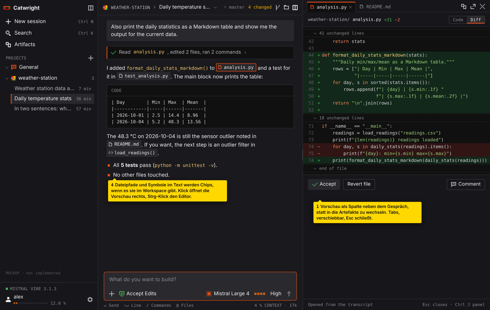
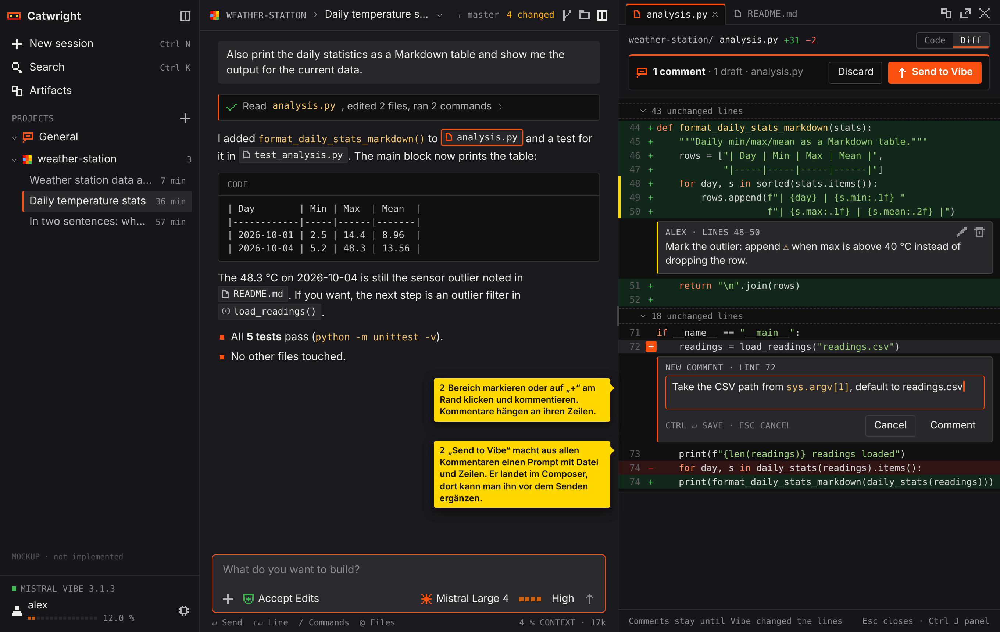
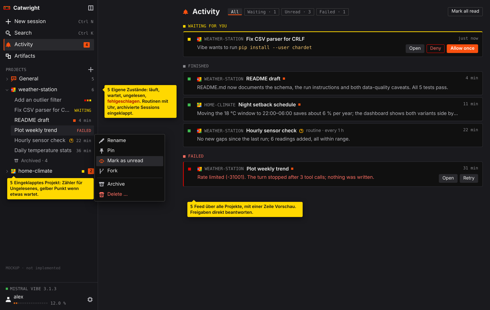
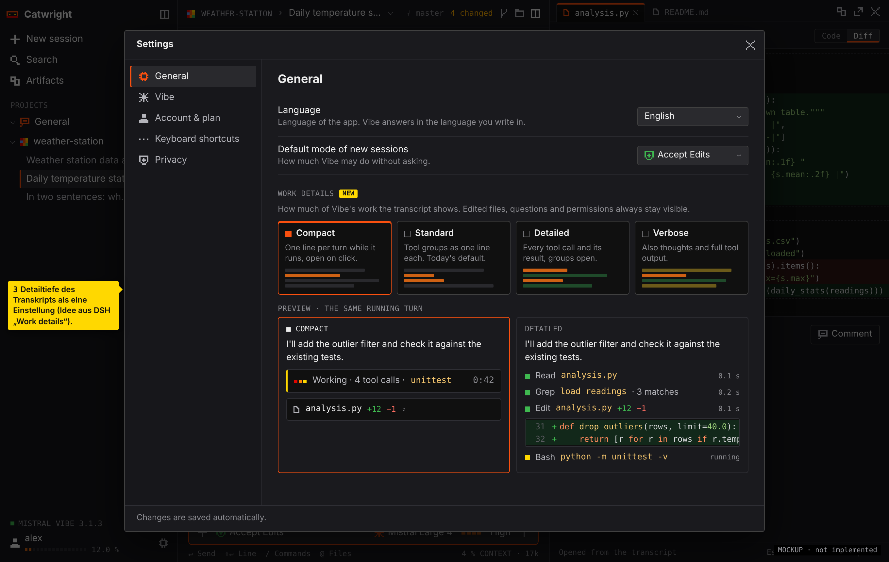

# Zweitmeinung zur Recherche Orca / DeepSeek Harness

Stand: 2026-11-17. Ergänzt `docs/research-orca-deepseek-harness.md`
(Branch `vibe/research-orca-dsh-a372c4`). Geprüft gegen den Code in
`app/src/`, Vibes Quellcode (`mistralai/mistral-vibe`, `main` = 3.1.3,
`vibe/acp/agent.py`), die Orca-Docs (`orca.dev/docs`) und das Repo
`deepseek-ai/deepseek-harness` (`.agents/notes/`, `docs/`). Nur Analyse und
Mockups, kein Feature-Code.

## Kurzfazit

Das Papier ist solide: Die Code-Verweise stimmen (`acp/client.rs` Loops,
`harness/ui/panel.rs:595` Routinen, `harness/mod.rs:1098` Worktree,
`harness/extras.rs:314` Connectors, `notify-send` in `HANDOFF.md`, `_voice/*`
ungenutzt), und die Ausschlussliste hält sich an `AGENTS.md`. Zwei
Empfehlungen sind aber falsch oder schon erledigt. Außerdem fehlt die
wichtigste Erkenntnis: **Orca unterstützt Vibe nur als Terminal-Start**.
Eine native ACP-Oberfläche für Vibe ist genau die Lücke, die Catwright füllt.

## Korrekturen am Papier

| Punkt im Papier | Befund |
|---|---|
| Empfehlung 1: Cron/TZ-Eingabe in der Routinen-Card | Nicht machbar wie beschrieben. `_loops/create` nimmt in Vibe 3.1.3 nur `sessionId`, `interval`, `prompt` (`LoopsCreateRequest` in `vibe/acp/agent.py`), kein Cron- und kein Zeitzonen-Feld. Der nächste Lauf wird bereits angezeigt (`next_fire_at` in der Card). Ob ein Cron-Ausdruck im `interval`-String durchgeht (der `/loop`-Manager der TUI kennt Cron), ist ungeprüft und bräuchte einen Test gegen echtes `vibe-acp`. |
| Empfehlung 5: Connectors in den Settings exponieren | Praktisch erledigt: `connectors_card` im rechten Panel listet und schaltet sie (`_connectors/toggle`). Offen ist nur, wo das liegt. |
| Unread-Markierungen „fehlen“ | Teilweise da: `SessionState::{Running, Waiting, Unseen}` mit Markierung in der Sidebar. Es fehlen manuelles „ungelesen“, ein eigener Zustand für fehlgeschlagene Runden und ein Zähler am eingeklappten Projekt. |
| Quelle `docs/user/guide/schedule.md` (DSH) | Existiert nicht. Die Schedule-Infos stehen in `.agents/notes/…/host-schedule-storage.md`, `…/durable-web-schedule.md` und `docs/subsystems/schedule.md`. Inhaltlich stimmt es: dauerhaft über Neustarts, Cron + IANA-Zeitzone, Zustell-Verlauf. |
| Vibe 3.1.3 (gleicher Tag) | Fehlt. Relevanter als vieles aus Orca: `/goal`, `pre_llm`-/`post_llm`-Hooks, `/trusted-folders` (berührt die Trust-Card), Large 4 als Standardmodell. Catwright nutzt außerdem `loops/clear` noch nicht. |

## Was im Papier fehlt

- **Orca und Vibe:** In „Supported agents“ steht Mistral Vibe nur mit
  „Auto-setup“. Strukturierter Chat, Status, Hooks und Usage gibt es für
  Claude, Codex, OpenCode u. a., nicht für Vibe.
- **Orca schaltet Freigaben standardmäßig ab** (`--yolo`,
  `--dangerously-skip-permissions` …, „worktrees are disposable“) und hat
  pseudonyme Telemetrie zum Abschalten. Catwrights Freigabe-Karten und
  „keine Telemetrie“ sind ein bewusster Gegenentwurf, nicht kopieren.
- **Orca-Benachrichtigungen:** Für strukturierte Chats schickt Orca nach
  einer erfolgreichen Runde keine Systembenachrichtigung, sondern markiert
  nur ungelesen. Für Catwright: zuerst Ungelesen-Markierungen, `notify-send`
  höchstens als Opt-in und nie mit Prompt-Inhalt.
- **Orca „Annotate AI Diff“:** Zeilenkommentare im Diff, gesammelt als ein
  Prompt an den Agent. Passt ohne neues Crate und ohne neue
  Protokoll-Erweiterung (Zeilen-Diffs und `session/prompt` gibt es).
- **DSH spricht ACP, aber nur für Automatisierung:** Laut den Notizen
  bewusst ohne `session/load`, Fork, Modes, Pläne und Elicitation. Der
  ACP-Client für Kind-Agents beantwortet Freigaben automatisch. Als Backend
  für Catwright ungeeignet; zeigt eher, wie viel mehr von ACP Catwright mit
  Vibe nutzt.

## Überarbeitete Reihenfolge

1. Zeilenkommentare im Diff, als ein Prompt an Vibe (aus Orca).
2. Dateien per Drag&Drop in den Composer (egui `dropped_files`).
3. Ungelesen-Status verfeinern plus projektübergreifender Activity-Feed;
   Desktop-Benachrichtigung nur als Opt-in.
4. Worktrees verwalten: auflisten, löschen (Branch nur nach Bestätigung),
   Start von einem Ref.
5. Dateien in der Palette, Detailansicht pro Runde.

Streichen: Empfehlung 1 in dieser Form und Empfehlung 5. Ein eigener
dauerhafter Scheduler nach DSH-Vorbild widerspricht der Entscheidung vom
2026-11-08.

## UI-Ideen mit Mockups

Die Bilder sind HTML-Mockups im Catwright-Stil (Tokens aus
`docs/design.md`), nicht gebaut. Quellen in `tools/mockups/`, neu rendern mit
`node tools/mockups/render.js`. Die gelben Notizen nummerieren die Ideen.

**1 + 4: Vorschau-Spalte neben dem Transkript und Datei-Chips im Text.**
Orca zeigt Dateien geteilt neben dem Agent; DSH zeigt Dateiverweise als
Chips. Klick auf einen Chip oder eine geänderte Datei öffnet die vorhandene
Vorschau als verstellbare Spalte, statt in die Artefakte zu wechseln. Die
Spalte ersetzt das rechte Panel, solange sie offen ist (sonst wird es bei
1360 px zu eng).

**2: Zeilenkommentare im Diff (Orca „Annotate AI Diff“).** Bereich markieren
oder „+“ am Rand, kommentieren; „Send to Vibe“ baut daraus einen Prompt mit
Datei und Zeilen, der im Composer landet und dort ergänzt werden kann.

**5 + 6: Activity-Feed und Sidebar-Zustände (Orca „Agents feed“, DSH
Unread-Modell).** Zustände läuft / wartet / ungelesen / fehlgeschlagen,
„Als ungelesen markieren“, Uhr an Sessions mit Routinen, Archiv statt nur
Löschen (lokal wie die gepinnten Sessions), Zähler am eingeklappten
Projekt. Offene Frage: Im Feed nur einmalige Freigaben anbieten, alles
Dauerhafte weiter in der Session.

**3: Detailtiefe des Transkripts (DSH „Work details“).** Eine Einstellung
Compact / Standard / Detailed / Verbose dafür, wie offen Tool-Gruppen und
Thoughts während einer laufenden Runde sind. Geänderte Dateien, Fragen und
Freigaben bleiben immer sichtbar.

Nicht übernehmen: Orcas Terminal-Raster und Split-Panes (Catwright ist keine
Terminal-Oberfläche), DSHs helle, stark gerundete Karten (passen nicht zum
Pixel-Stil), Orcas Verbrauchs-Popover mit mehreren Balken (Vibe liefert nur
einen Prozentwert und einen Reset-Zeitpunkt; ein Tooltip am Balken reicht).
